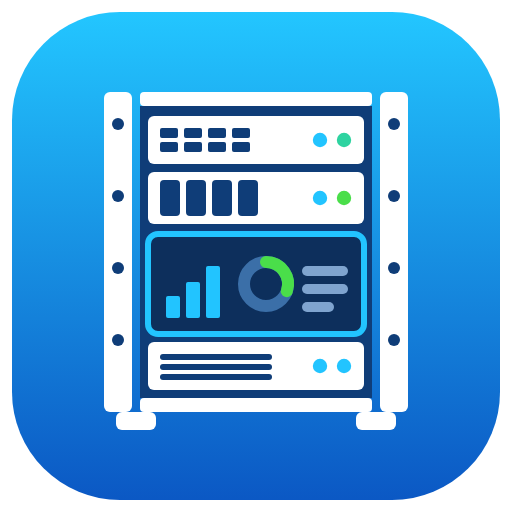
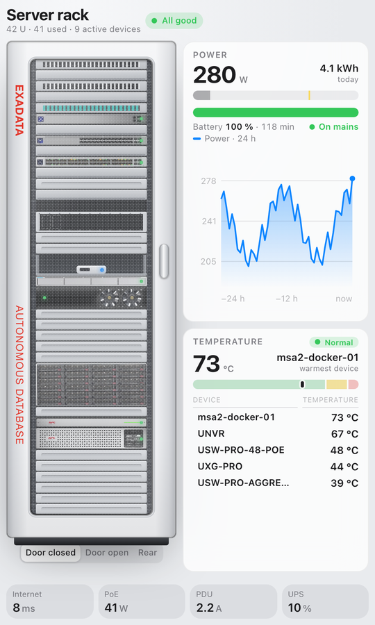
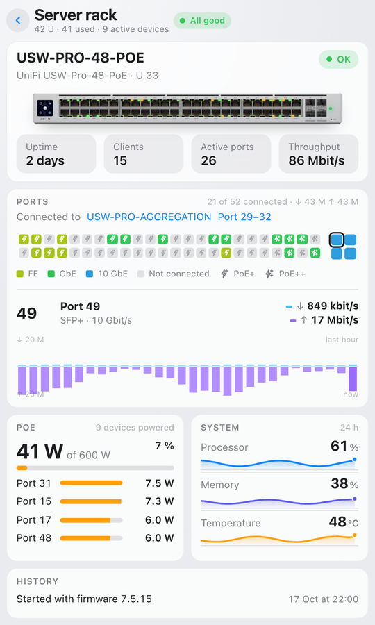
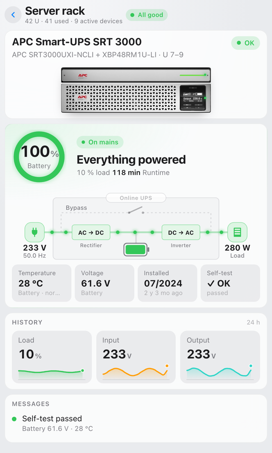
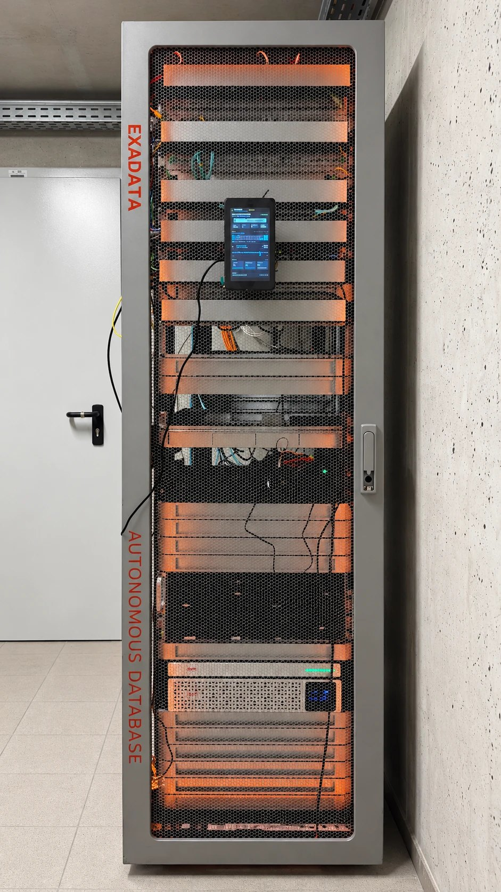
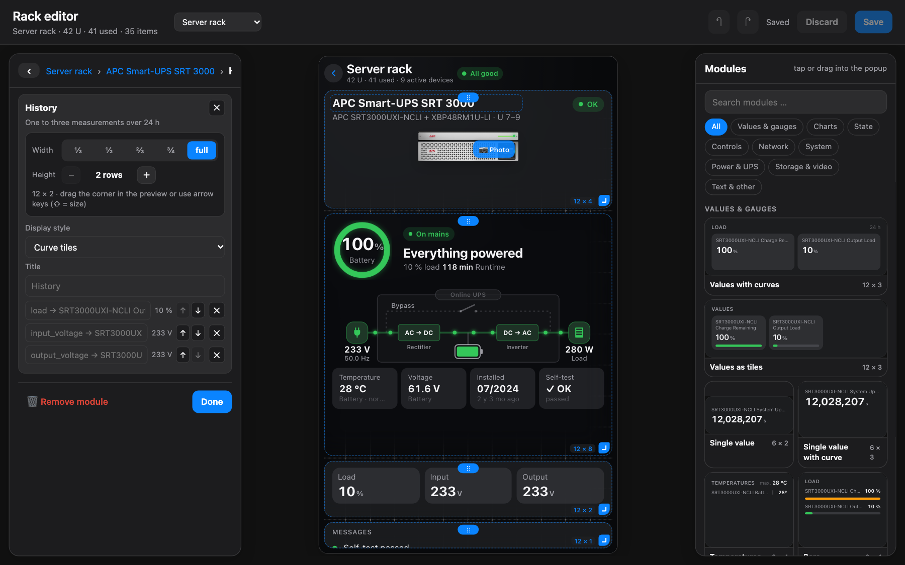

# Rack Display

[](https://github.com/42bios/ha-rack-display/actions/workflows/ci.yml)
[](https://github.com/42bios/ha-rack-display/actions/workflows/validate-hacs.yml)
[](https://github.com/42bios/ha-rack-display/actions/workflows/hassfest.yml)
[](https://my.home-assistant.io/redirect/hacs_repository/?owner=42bios&repository=ha-rack-display&category=integration)
[](https://github.com/42bios/ha-rack-display/releases)

Home Assistant custom integration that shows your server rack as an interactive view – in its own panel (`/rack`), on a touch display mounted right at the rack (e.g. a Raspberry Pi running TouchKio), or inside a dashboard.



> **Disclaimer:** This is an unofficial, community-maintained integration and is not affiliated with, endorsed by, or supported by Ubiquiti, APC/Schneider Electric or any other device manufacturer. All product names, logos, and brands are property of their respective owners and are used for identification purposes only.

<p align="center">
  
  
  
  
</p>
<p align="center"><sub>Overview · switch with ports and live throughput · UPS with power flow · prototype mounted on the rack door</sub></p>

## Highlights

- **Rack view** with door, front and rear side, rack units and device faces (ports, LEDs, fans), plus an overview of power, temperatures and notices for the whole rack.
- **Detail popup per device**, built from modules: switch ports with speed, PoE and throughput, UPS power path, NVR storage and drives, server load and temperatures, PDU outlets – or generic values, bars and charts for any entity.
- **Visual editor:** build the rack, link devices to Home Assistant devices, arrange modules, upload photos and pick the target display (Pi portrait/landscape, HD, tablet, custom size).
- **Entities per rack** for automations: state (OK / warning / fault), number of faults and warnings, hottest device and a problem binary sensor.
- **Night mode, heat map and energy cost** per day and month.
- **Several racks**, export/import as JSON, and a dashboard card.
- **English and German**, following the language of the Home Assistant user; light/dark mode follows the theme.

<!-- ha-marketplace:exclude-start -->
## Installation

Requires Home Assistant 2024.10 or newer.

[](https://my.home-assistant.io/redirect/hacs_repository/?owner=42bios&repository=ha-rack-display&category=integration)

The button opens the Marketplace on Home Assistant 2026.11 or newer, and HACS on older versions. Use it if the search does not find Rack Display yet.

### Marketplace (Home Assistant 2026.11 or newer)

1. Open `Settings → Marketplace` and search for `Rack Display`.
2. Install it.

### HACS (older Home Assistant versions)

1. Open HACS and search for `Rack Display`.
2. Download it and restart Home Assistant.

### Manual

1. Copy `custom_components/rack_display` into the `custom_components` folder of your Home Assistant configuration.
2. Restart Home Assistant.
<!-- ha-marketplace:exclude-end -->

## Setup

[](https://my.home-assistant.io/redirect/config_flow_start/?domain=rack_display)

Add the integration under `Settings → Devices & services → Add integration → Rack Display`. The rack is then available at `/rack` and in the sidebar.

## Editor

Build the rack and design every popup in the rack editor (`Settings → Devices & services → Rack Display → Configure`): settings on the left, the live preview with its grid in the middle, the module library on the right. Drag modules into the popup, resize them at the corner and pick entities with suggestions from the linked device.

<p align="center"></p>

Entities from these integrations, among others, are mapped automatically: UniFi Network (including *UniFi Network Plus*), UniFi Protect, APC UPS (SNMP/NMC), APC Rack PDU, Glances, System Monitor. Anything else can be assigned manually.

The drive bays module places disks in order by default; under module → "Disk → bay" each disk can get its bay number, and bays can be numbered by row or by column.

## Dashboard card

```yaml
type: custom:rack-display-card
rack_id: serverrack   # optional, default: first rack
view: rack            # optional: only the rack with its status (good for several racks side by side)
height: 560           # optional, card height in px
```

## Raspberry Pi as rack display

The Pi only shows the Home Assistant page `/rack` full screen – no extra server needed. On a Raspberry Pi OS **with desktop** (Bookworm or Trixie):

```bash
curl -fsSLO https://raw.githubusercontent.com/42bios/ha-rack-display/main/scripts/pi-kiosk.sh
chmod +x pi-kiosk.sh
./pi-kiosk.sh --url http://homeassistant.local:8123/rack --rotate 90
```

- `--mode touchkio` (default) installs [TouchKio](https://github.com/leukipp/touchkio): screen on/off, brightness, reload and screenshot become HA entities via MQTT, so HA can switch the screen off after a few minutes.
- `--mode browser` only runs Chromium in kiosk mode; `--screen-off 5` blanks the screen after 5 minutes without touch.
- Log in once on the display (a dedicated non-admin user is recommended). The display language can be fixed per rack in the editor (Display → Language).

## Blueprints

**Notify on rack fault** – push notification with the affected devices when `binary_sensor.<rack>_problem` turns on, with an optional "resolved" message.

[](https://my.home-assistant.io/redirect/blueprint_import/?blueprint_url=https%3A%2F%2Fgithub.com%2F42bios%2Fha-rack-display%2Fblob%2Fmain%2Fblueprints%2Fautomation%2Frack_display%2Frack_problem_notify.yaml)

**Switch the TouchKio screen off when idle**

[](https://my.home-assistant.io/redirect/blueprint_import/?blueprint_url=https%3A%2F%2Fgithub.com%2F42bios%2Fha-rack-display%2Fblob%2Fmain%2Fblueprints%2Fautomation%2Frack_display%2Ftouchkio_screen_off.yaml)

## Contributing

Device popups are built from modules, and anyone can add one: a folder in [`modules/`](modules/README.md) with a description, a render function and optional CSS. See [CONTRIBUTING.md](CONTRIBUTING.md) for modules, translations, the build and releases.

## Support

Use [Issues](https://github.com/42bios/ha-rack-display/issues) to report bugs or request features, and [Discussions](https://github.com/42bios/ha-rack-display/discussions) to ask questions and share your setup.

<a href="https://www.buymeacoffee.com/42bios">
  
</a>

## License

Rack Display is licensed under the [GNU General Public License v3.0](LICENSE). You may use, modify and share it; modified versions you distribute must stay under the GPLv3 and include their source code.
