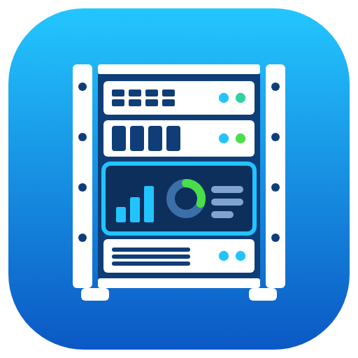
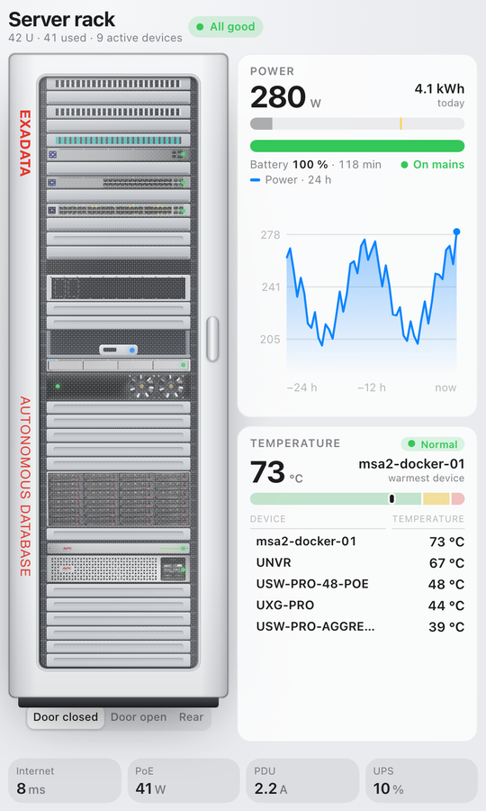
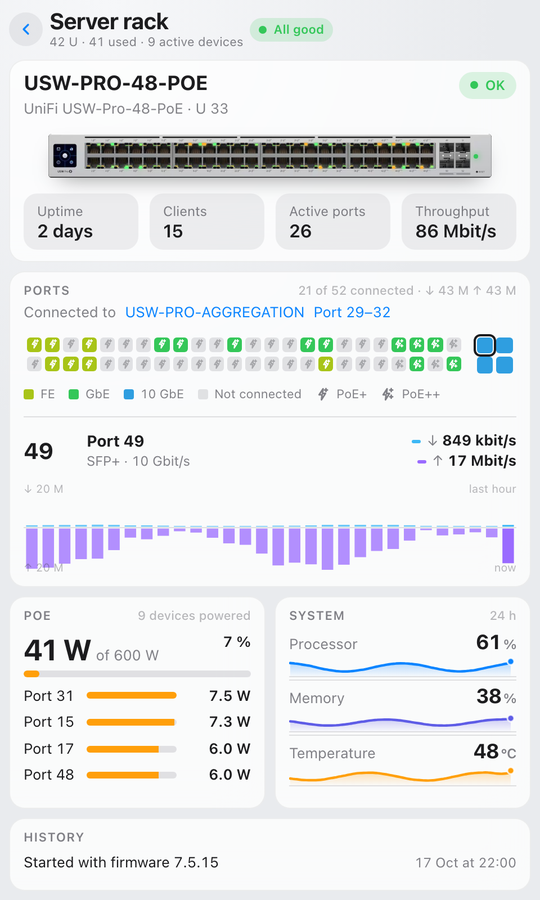
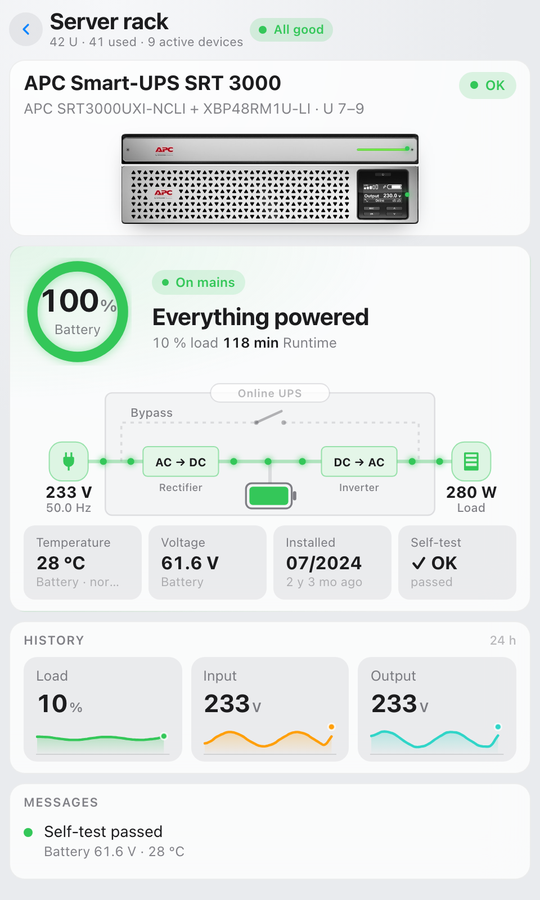
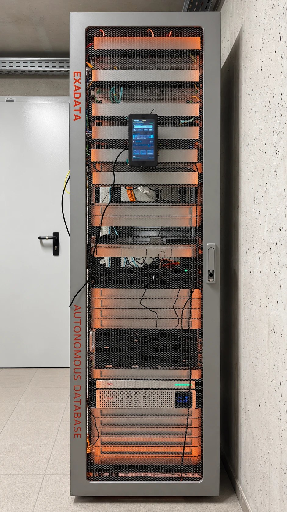
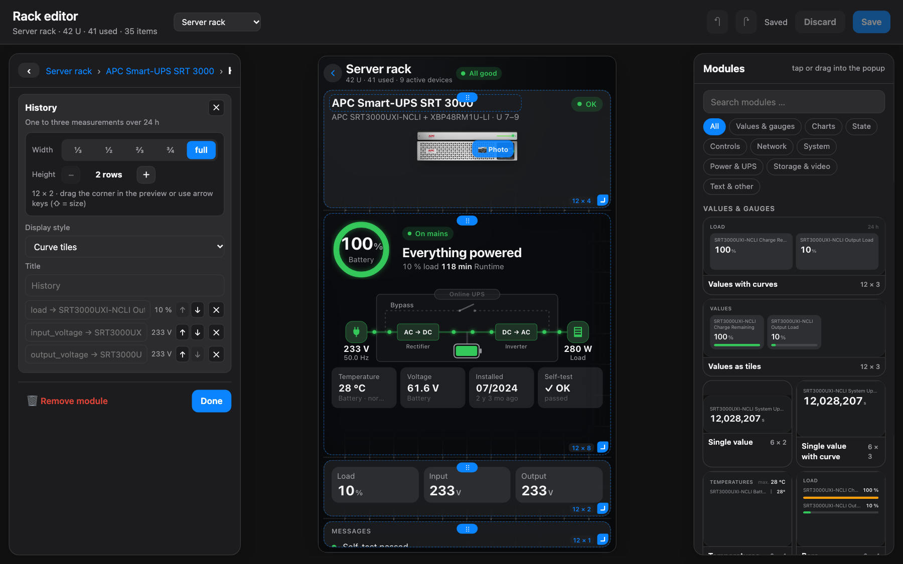

# Rack Display

[](https://github.com/42bios/ha-rack-display/actions/workflows/ci.yml)
[](https://github.com/42bios/ha-rack-display/actions/workflows/validate-hacs.yml)
[](https://github.com/42bios/ha-rack-display/actions/workflows/hassfest.yml)
[](https://hacs.xyz/)
[](https://github.com/42bios/ha-rack-display/releases)
[](https://buymeacoffee.com/42bios)

Home Assistant custom integration that shows your server rack as an interactive view – in its own panel (`/rack`), on a touch display mounted right at the rack (e.g. a Raspberry Pi running TouchKio), or inside a dashboard.



[](https://my.home-assistant.io/redirect/hacs_repository/?owner=42bios&repository=ha-rack-display&category=integration)

> **Disclaimer:** This is an unofficial, community-maintained integration and is not affiliated with, endorsed by, or supported by Ubiquiti, APC/Schneider Electric or any other device manufacturer. All product names, logos, and brands are property of their respective owners and are used for identification purposes only.

<p align="center">
  
  
  
  
</p>
<p align="center"><sub>Overview · switch with ports and live throughput · UPS with power flow · prototype mounted on the rack door</sub></p>

## Features

- **Rack view** with door, front and rear side, rack units and device faces (ports, LEDs, fans)
- **Overview**: power, temperatures, notices and key figures for the whole rack
- **Detail view per device**, built from modules:
  - Switches/gateway: ports in UniFi style (speed, PoE+/PoE++, uplink, aggregation), throughput history
  - UPS: battery, operating mode, power path of an online (double-conversion) UPS including bypass, battery and maintenance values
  - NVR: storage (RAID, used/free/protection), drives, recording
  - Servers: utilisation, network interfaces, temperatures with a traceable history chart
  - PDU: outlets with labels, power and current
  - Generic modules: values, bars, status, history, note – with any entity
- **Editor** (integration page → Configure): build the rack, link devices to Home Assistant devices, add and reorder modules, assign and rename entities, upload photos, choose the target display (Pi portrait/landscape, HD, tablet, custom size), undo/redo
- No scrollbars, light/dark mode follows the HA theme, automatic return to the overview after inactivity
- **Home Assistant entities** per rack: state (OK / warning / fault), number of faults and warnings, hottest device and a problem binary sensor – for automations and notifications (can be switched off per rack)
- **Night mode** (dimmed, dark, no blinking) for a time window, **heat map** of device temperatures in the rack, **energy cost** per day and month when an electricity price is set
- **Export / import** of a rack as a JSON file
- **Several racks side by side**: dashboard card with `view: rack` (rack and status only; tapping a device opens it on the Rack page)
- **Languages**: German and English, following the language of the Home Assistant user (other languages use English; translations live in `frontend-src/i18n/`)

## Installation

### HACS (recommended)

1. Open HACS in Home Assistant.
2. Open the menu (three dots) → `Custom repositories`.
3. Repository URL: `https://github.com/42bios/ha-rack-display`, category: `Integration`.
4. Install **Rack Display** and restart Home Assistant.
5. Add the integration in `Settings → Devices & services → Add integration → Rack Display`.

### Manual

Copy `custom_components/rack_display` into `config/custom_components` and restart Home Assistant.

## Editor

Build the rack and design every popup in the rack editor (Settings → Devices & services → Rack Display → Configure): settings on the left, the live preview with its grid in the middle, the module library on the right. Drag modules into the popup, resize them at the corner and pick entities with suggestions from the linked device.

<p align="center"></p>

## Supported data

Entities from these integrations, among others, are mapped automatically: UniFi Network (including *UniFi Network Plus*), UniFi Protect, APC UPS (SNMP/NMC), APC Rack PDU, Glances, System Monitor. Anything else can be assigned manually in the editor.

> The interface is available in English and German. It follows the language of the Home Assistant user and can be fixed per rack in the editor (Display → Language).

## Dashboard card

```yaml
type: custom:rack-display-card
rack_id: serverrack   # optional, default: first rack
view: rack            # optional: only the rack with its status (good for several racks side by side)
height: 560           # optional, card height in px
```

## Raspberry Pi as rack display

The Pi only shows the Home Assistant page `/rack` full screen – no extra server needed. On a Raspberry Pi OS **with desktop** (Bookworm or Trixie):

```bash
curl -fsSLO https://raw.githubusercontent.com/42bios/ha-rack-display/main/scripts/pi-kiosk.sh
chmod +x pi-kiosk.sh
./pi-kiosk.sh --url http://homeassistant.local:8123/rack --rotate 90
```

- `--mode touchkio` (default) installs [TouchKio](https://github.com/leukipp/touchkio): screen on/off, brightness, reload and screenshot become HA entities via MQTT, so HA can switch the screen off after a few minutes.
- `--mode browser` only runs Chromium in kiosk mode; `--screen-off 5` blanks the screen after 5 minutes without touch.
- Log in once on the display (a dedicated non-admin user is recommended). The display language can be fixed per rack in the editor (Display → Language).

## Drive bay assignment

The drive bays module places disks in order by default; in the editor (module → "Disk → bay") each disk can get its bay number, and bays can be numbered by row or by column.

## Blueprints

- **Notify on rack fault** – push notification with the affected devices when `binary_sensor.<rack>_problem` turns on (optional "resolved" message): [`rack_problem_notify.yaml`](blueprints/automation/rack_display/rack_problem_notify.yaml)
- **Switch the TouchKio screen off when idle**: [`touchkio_screen_off.yaml`](blueprints/automation/rack_display/touchkio_screen_off.yaml)

Import them in HA under Settings → Automations & scenes → Blueprints → Import blueprint (using the file's GitHub URL).

## Modules

Device popups are built from modules (values, charts, ports, bays, …). Anyone can add a new module: a folder in [`modules/`](modules/README.md) with a description, a render function and optional CSS – open a pull request and a GitHub check validates it. See [CONTRIBUTING.md](CONTRIBUTING.md).

## Development

The frontend source lives in `frontend-src/` and is built into `custom_components/rack_display/frontend/` with `python3 frontend-src/build.py`. `frontend-src/deploy.sh` builds the integration and copies it to a Home Assistant host via SSH; the connection details are read from `frontend-src/deploy.env` (not part of the repository).

## Releases

- Create and push a semantic tag, for example `v0.2.0`.
- The `Release` workflow publishes a GitHub release with notes grouped via `.github/release.yml`.

## Support

If you find this project useful, you can [buy me a coffee](https://buymeacoffee.com/42bios) to support development and testing.

- Issues: https://github.com/42bios/ha-rack-display/issues
- Releases: https://github.com/42bios/ha-rack-display/releases

## License

Rack Display is licensed under the [GNU General Public License v3.0](LICENSE). You may use, modify and share it; modified versions you distribute must stay under the GPLv3 and include their source code.
